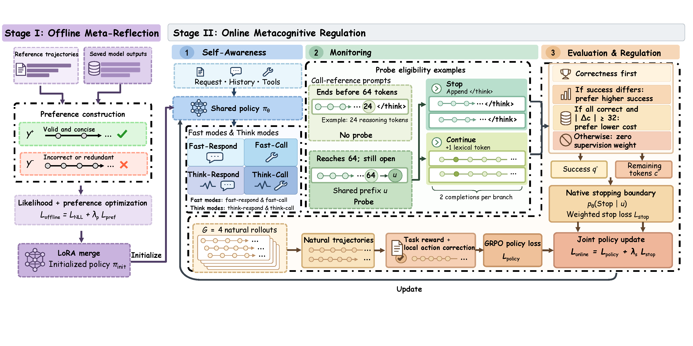

# Metatool 
This is the demo RL training code for the paper:"MetaTool : Thinking Just Enough, Calling Tools When Needed" . 

# Model Structure


## Run

```bash
python run.py train \
  --model /absolute/path/to/Qwen3-8B \
  --train-data /absolute/path/to/train.parquet \
  --validation-data /absolute/path/to/validation.parquet \
  --work /absolute/path/to/metatool_rl_work \
  --gpus 0,1,2,3,4,5
```
## Checkpointing and Recovery

Each training step saves all 384 main rollouts, including the actual generated token IDs, prompt IDs, decoded text, and labels. Auxiliary branch outputs, state selections, and supervision targets are also saved. Inactive placeholder slots are excluded from the count of generated outputs.

At step 50, a recovery checkpoint saves the model, optimizer, scheduler, RNG states, driver and dataloader states, and supported rollout states. This checkpoint is deleted only after the step-100 checkpoint has been saved and verified. Once the final model has been exported and verified, the run's training checkpoints are removed. The input model, final model, all rollouts, and logs are retained.

```bash
# After resolving a failure, resume from the complete step-50 checkpoint.
python run.py train --work /absolute/path/to/metatool_rl_work \
  --gpus 0,1,2,3,4,5 --resume

# Use only when preflight checks failed before any optimizer updates.
python run.py train --work /absolute/path/to/metatool_rl_work \
  --gpus 0,1,2,3,4,5 --retry-preflight

# Complete model export or cleanup after training, without further training.
python run.py finalize --work /absolute/path/to/metatool_rl_work
```

Recovery uses the registered model and dataset paths; these inputs cannot be changed when resuming. No recovery checkpoint is available for failures before step 50. The launcher does not automatically repeat training that has already consumed the allocated budget. Bitwise equivalence of full distributed GPU recovery has not been revalidated for this release.

| Output | Path relative to `WORK` |
|---|---|
| Final model | `runs/metatool_seed42/merged_hf/` |
| All main rollouts | `runs/metatool_seed42/main_rollouts/` |
| Auxiliary outputs and targets | `runs/metatool_seed42/branch_probes/` |
| Launch and error logs | `runs/metatool_seed42/attempts/` |
| Training counts | `runs/metatool_seed42/TRAINING_SUMMARY.json` |
| Registered model and external datasets | `INSTALL.json` |

Generated rollouts are stored under `WORK`, not in the release package's `data/` directory. Disk checks use the actual remaining free space after accounting for existing files. The step-50 checkpoint is not deleted early to free disk space.

## API-Bank Evaluation

```bash
FINAL=/absolute/path/to/metatool_rl_work/runs/metatool_seed42/merged_hf
python run.py evaluate --model "$FINAL" \
  --output /absolute/path/to/metatool_rl_work/eval_api --gpu 0
```

Evaluation preserves the fixed set of 597 examples, the original parser and soft-match rules, and the sampling settings. Raw generation chunks are saved before parsing and scoring. Evaluation runs in a separate vLLM process.

Existing predictions can be scored on CPU:

```bash
CUDA_VISIBLE_DEVICES="" python run.py score \
  --predictions /absolute/path/to/predictions.jsonl \
  --output /absolute/path/to/api_scores.json
```

## Environment

Reuse an existing environment with the required core versions whenever possible: Python 3.10.21, PyTorch 2.6.0+cu124, Transformers 4.51.3, vLLM 0.8.5.post1, and Ray 2.47.1. See `configs/environment.json` for the version configuration.

Example installation in a new environment:

```bash
python -m venv .venv
source .venv/bin/activate
python -m pip install --upgrade pip
python -m pip install torch==2.6.0 --index-url https://download.pytorch.org/whl/cu124
python -m pip install -r requirements.txt
python -m pip install flash-attn --no-build-isolation
```

FlashAttention must be compatible with the installed PyTorch and CUDA versions. The source archive did not include a complete dependency and compiler lockfile, and installation in a fresh GPU environment has not been validated for this release. The model architecture, native token IDs, tokenizer and chat template, batch configuration, and distributed layout are tied to the current configuration. See `configs/model_profile.json` for the metadata requirements. The tokenizer files must be supplied with the input model.

## Project Structure and CPU Validation

- `metatool/rl/`: token credit assignment, action correction, Stop/Continue supervision, rollout logging, and recovery.
- `vendor/verl/`: the distributed training engine and its adaptations.
- `runtime/`: external input registration, training launch, model export, and cleanup.
- `metatool/evaluation/`: API-Bank inference and scoring.
- `data/api_bank/`: the only datasets included in this package.

`vendor/verl/verl/third_party/` contains dependency compatibility layers, not additional training methods or datasets. The current generation and weight-synchronization paths use `vllm/`. The `torch/` directory provides compatibility code for loading FSDP2 states with older PyTorch versions; it is inactive under the current FSDP1 configuration. The `sglang/` directory supports an alternative inference backend and is inactive under the current vLLM configuration. These compatibility components and their copyright notices are retained and are not presented as methodological contributions of MetaTool. Unused mathematics and search-tool examples have been removed.

`vendor/verl/verl/single_controller/` provides the multi-GPU task orchestration used by the current training pipeline. It uses Ray to create GPU workers, allocate resources, dispatch batches and remote method calls, and collect results from each rank. Here, “single” refers to a central controller; computation is performed by multiple GPU workers. MetaTool's decision and loss implementations are located in `metatool/rl/`.
```bash
CUDA_VISIBLE_DEVICES="" python tests_cpu.py
```

